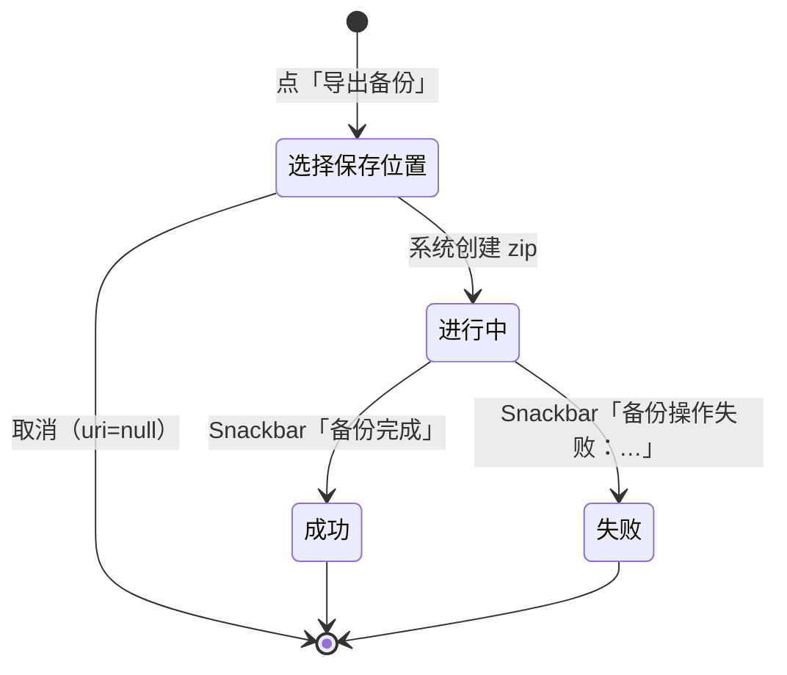
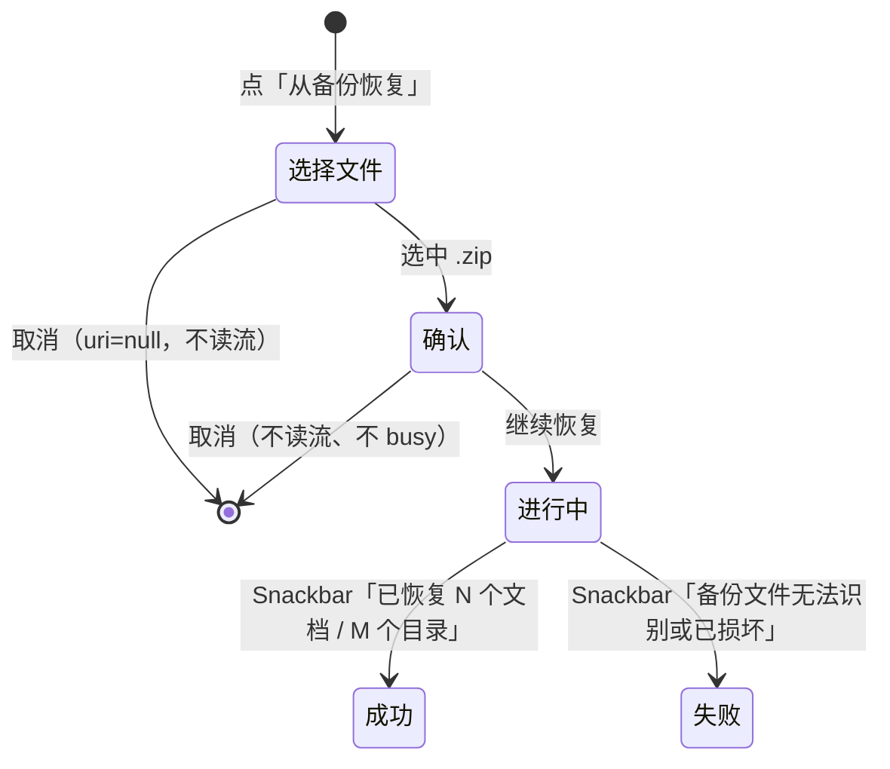

# 流程 · 备份导出与恢复

- 状态：评审通过
- 优先级：P0（D1 恢复二次确认，T1）
- 关联决策：D1
- 代码落点：`feature/settings/SettingsScreen.kt`、`SettingsViewModel.kt`、`core/data/backup/BackupManager.kt`、`BackupCodec.kt`

## 1. 目标

把「文档物理文件 + 缩略图 + 元数据/进度快照」打包为单 zip，便于换机与卸载重装后恢复；恢复必须可解释、可取消、不产生意外覆盖。

## 2. 导出



- SAF `CreateDocument("application/zip")`，默认文件名 `myreader-backup.zip`。
- 进行中：备份组内「环 + 状态文案 + 线性进度」，两个入口隐藏。
- 流关闭由后台协程在写完后执行（UI 不得提前关闭）。
- 成功后文件落在用户选择位置，可在系统文件管理器查看。

## 3. 恢复（D1 / T1）



确认对话框（新增）：

```
┌──────────────────────────────┐
│ 从备份恢复                     │
│ 将合并备份中的 {n} 个文档 /     │
│ {m} 个目录：同名记录以备份为准，  │
│ 备份之外的数据不受影响。         │
│              [取消] [继续恢复]  │
└──────────────────────────────┘
```

规则：

1. 确认发生在**打开输入流之前**；取消时不得读取文件。
2. 文案中的 `{n}/{m}` 若无法在读取前得知，退化文案为「将合并备份中的目录与文档记录：同名记录以备份为准，备份之外的数据不受影响。是否继续？」——**不得为了显示数字而先解析整个 zip**。
3. 恢复为合并式 upsert：不删除现有数据；同 id 记录以备份覆盖。
4. 恢复期间入口隐藏，进度与导出同一形态。

## 4. 校验与失败

| 校验 | 规则 | 失败文案 |
|---|---|---|
| zip 可读 | 文件头/结构合法 | `err_backup_invalid` |
| schemaVersion | 兼容当前版本；旧版本允许（书签为空） | 同上 |
| 路径白名单 | `relPath` 不得越出 `filesDir`（防 zip slip） | 同上（`[建议]` 记日志便于排查） |
| 空间 | 解压前预检可用空间 | `err_storage_low` 语境化文案（`[建议]`） |
| 中途异常 | 事务回滚已解压内容 | `err_backup_op` |

文案要求：用户侧不出现异常类名/堆栈（现状 `备份操作失败：${e.message ?: e.javaClass.simpleName}` 需按 `copy.md` 收敛）。

## 5. 数据契约（设计关注点）

| 项 | 约束 |
|---|---|
| 包含内容 | `library/` 物理文档、`thumb/` 缩略图、`library.json` 元数据快照 |
| 不包含 | 偏好设置（DataStore）、缓存 |
| 进度 | `currentPage` / `scrollOffsetY` / `progressType` / `progressPayload` / `lastReadAt` 逐字段保留 |
| 加密文档 | `needsPassword = true`、`pageCount = -1` 保留，首开仍需密码 |
| 幂等 | 重复恢复同一备份：记录不重复增长（upsert），物理文件覆盖 |

## 6. 状态矩阵

| 状态 | 触发 | 展示 | 可操作 |
|---|---|---|---|
| 空闲 | — | 「导出备份」「从备份恢复」两行 | 两者可点 |
| 导出进行中 | busy | 环 + 状态 + 线性进度 | 其他分组可操作；入口隐藏 |
| 恢复确认中 | 选完 zip | 确认对话框 | 继续 / 取消 |
| 恢复进行中 | 确认后 | 同上 | 同上 |
| 完成 | 成功 | Snackbar | 可再次操作 |
| 失败 | 异常 | Snackbar | 可重试 |
| 取消 SAF | uri null | 无变化 | — |

## 7. 无障碍

| 项 | 要求 |
|---|---|
| 确认对话框 | 正文完整朗读（含"同名以备份为准"） |
| 进度 | `progressBarRangeInfo`，百分比可读 |
| 结果提示 | Snackbar 自动播报 |
| 触达 | 两行入口 ≥ 48dp |

## 8. 验收场景

1. 造数据（父子目录 + 加密文档 + 阅读进度）→ 导出 zip → 卸载重装 → 恢复：目录树、文档、进度逐字段一致，物理文件 SHA-256 一致；
2. 恢复前取消：数据零变化，无进度出现，无 Snackbar；
3. 恢复非备份 zip：报「备份文件无法识别或已损坏」，不崩溃、无残留文件；
4. 旧版本备份（schemaVersion 小）：恢复成功且新增字段为空（M10 书签场景）；
5. 恶意 zip（含 `../` 路径）：拒收，不写出 `filesDir`；
6. 重复恢复同一备份：文档数不翻倍；
7. 导出过程中按返回：操作继续（VM 存活）或按既定策略取消——需在验收中固定一种行为并记录；
8. 100MB+ 库导出：进度条推进，完成提示出现，无 OOM/ANR。
