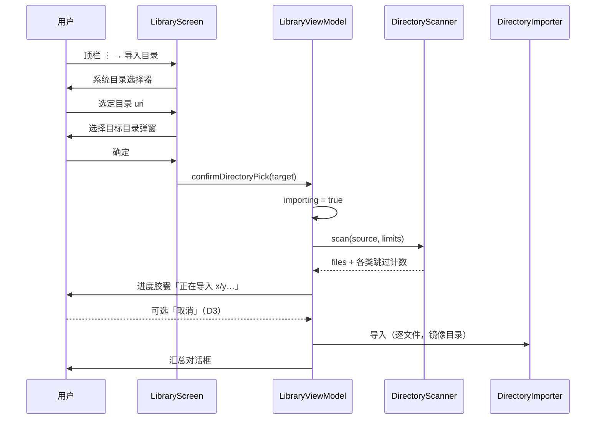

# 流程 · 整目录批量导入

- 状态：评审通过
- 优先级：P0（D3 取消，T3）
- 关联决策：D3
- 代码落点：`feature/library/DirectoryScanner.kt`、`DirectoryImporter.kt`、`LibraryViewModel.kt`、`ImportSummaryDialog.kt`、`LibraryScreen.kt`

## 1. 目标与入口

用户在系统目录树中选择一个目录，应用扫描其中受支持文档，按原目录结构镜像到库内指定位置，并给出可核对的汇总。

入口：书架顶栏 `⋮` → 导入目录（D2 收纳后）。

## 2. 阶段与上限

| 阶段 | 说明 | 上限/规则 |
|---|---|---|
| 选择源目录 | SAF `OpenDocumentTree`，立即取持久读授权 | 取权失败仍尝试导入（通常有单次读权限） |
| 选择目标位置 | `FolderPickerDialog`，默认当前目录 | 镜像结构创建在目标下 |
| 扫描 | BFS 非递归，按相对路径记录目录段 | 最多 500 文件；深度 8 层；单文件 200MB |
| 导入 | 逐文件复用单文件导入 | 内容 hash 命中 → 跳过（批量不逐个确认） |
| 收尾 | 删除本次创建但最终为空的目录 | 不留空目录 |
| 汇总 | 对话框 | 计数 + 明细 ≤ 50 条 |

超限处理：计入对应计数并继续，不中断整体导入。

## 3. 时序

## 4. 进度与反馈

| 阶段 | 文案 | 组件 |
|---|---|---|
| 扫描 | `loading_scan_dir`（正在扫描目录…） | 底部胶囊 + 18dp 环 |
| 导入 | `loading_import_progress`（正在导入 3/42…） | 同上 + 取消按钮（D3） |
| 完成 | `ok_import_summary_title` | 汇总对话框 |
| 无文件 | `err_pick_dir_empty` | Snackbar |
| 权限失效 | `err_pick_dir_permission` | Snackbar |
| 其他异常 | `err_import_dir` | Snackbar |
| 取消（D3） | `summary_cancelled` | 对话框（部分汇总） |

规则：`x/y` 的 `y` 为**可导入文件总数**（已排除不支持/超限项），不是扫描到的全部文件数。

## 5. 取消（D3 / T3）

实现要点（设计契约，供开发落地）：

1. `LibraryViewModel` 持有导入 `Job`；`cancelImport()` 调 `job.cancel()`。
2. `DirectoryImporter` 在每个文件处理前检查协程活性（`ensureActive()`），取消后立即停止。
3. 已成功导入的文件**不回滚**（避免二次删除风险），取消后弹部分汇总：
   - 标题沿用汇总标题；
   - 首行显示 `summary_cancelled`（已取消，已导入 {n} 个）；
   - 明细保留已完成项的跳过/失败原因。
4. 取消后 `importing = false`、`importProgress = null`；顶部胶囊消失。
5. 取消不得抛出未捕获异常；`CancellationException` 必须继续传播，不得被 `catch (Exception)` 吞掉后转成错误文案。

边界决策：
- 扫描阶段取消 = 不创建任何目录、不入库（最安全，推荐）。
- 导入阶段取消 = 保留已导入项（与"不丢用户已完成工作"一致）。

## 6. 汇总字段

| 字段 | 含义 | 显示 |
|---|---|---|
| `total` | 可导入文档数 | 恒显示 |
| `imported` | 成功 | >0 |
| `passwordMarked` | 加密标记 | >0 |
| `duplicateSkipped` | 库中已存在（批量静默跳过） | >0 |
| `corruptRejected` | 损坏 | >0 |
| `unsupported` | 不支持格式 | >0 |
| `tooLarge` | 超 200MB | >0 |
| `failed` | 其他失败 | >0 |
| `foldersCreated` / `foldersReused` | 新建/复用目录 | 恒显示 `c / r` |
| `renamedForConflict` | 同目录同名不同内容自动 `name (k)` | >0 |
| `deepSkipped` | 超 8 层 | >0 |
| `truncated` | 超 500 文件 | >0 |
| `inaccessibleDirs` | 无法访问的子目录 | >0 |
| `issues` | 逐条 `· 路径 —— 原因` | 非空，≤50 |

## 7. 幂等与冲突

- 同一目录重复导入：已存在内容 hash 命中 → 跳过；汇总显示「跳过 N」，**不重复创建目录**（同名复用）。
- 同名不同内容：自动重命名 `name (1).ext`，计入 `renamedForConflict`。
- 全部文件失败/重复的目录**不创建**（收尾清理空目录），避免书架残留空壳。
- 目录名规范化：trim、去控制字符、限长 64、空名回退「未命名目录」。

## 8. 异常与并发

- 导入期间再次触发导入：入口禁用；`importDirectory` 内部对 `importing` 二次防御。
- 导入期间离开页面：VM 存活，导入继续；返回后仍见进度或汇总。
- 应用被杀：已导入文件已入库，未处理部分丢弃（无断点续传，属既定范围）。

## 9. 无障碍

| 项 | 要求 |
|---|---|
| 进度胶囊 | `liveRegion` + 节流播报（≥1s） |
| 取消按钮 | CD「取消导入」，48dp |
| 汇总对话框 | 计数行可逐行朗读；`明细` 建议分组朗读而非全量连读 |
| 焦点 | 汇总打开后焦点进标题；取消后提示可被朗读 |

## 10. 验收场景

1. 夹具树（root/a1.pdf + outline_test.pdf、A/a2.txt + 损坏 a3.pdf、B 空、C/epub 重复 + note.docx）：汇总计数与设计逐项一致（成功 2 / 跳过 2 / 损坏 1 / 不支持 1 / 新建 1 / 复用 1）；
2. 空目录 B 与全失败目录 C：书架不残留空目录；
3. 同名不同内容：生成 `outline_test (1).pdf`，独立 hash，汇总「同名自动重命名 1」；
4. 幂等复跑：成功 0 / 跳过 4 / 新建 0 / 复用 2，DB 文档数不变；
5. 进度文案：扫描 → 导入 `x/y`，无跳号、无回退；
6. 深度 9 层目录：计入 `deepSkipped`，其余文件正常导入；
7. 501 个文件：前 500 处理，其余计入 `truncated`；
8. 250MB 单文件：计入 `tooLarge`；
9. 取消（T3）：导入 10/42 时取消 → 胶囊消失、弹部分汇总、前 10 个在书架可见、无崩溃；
10. 权限撤销后重试：`err_pick_dir_permission`，无部分脏数据。
