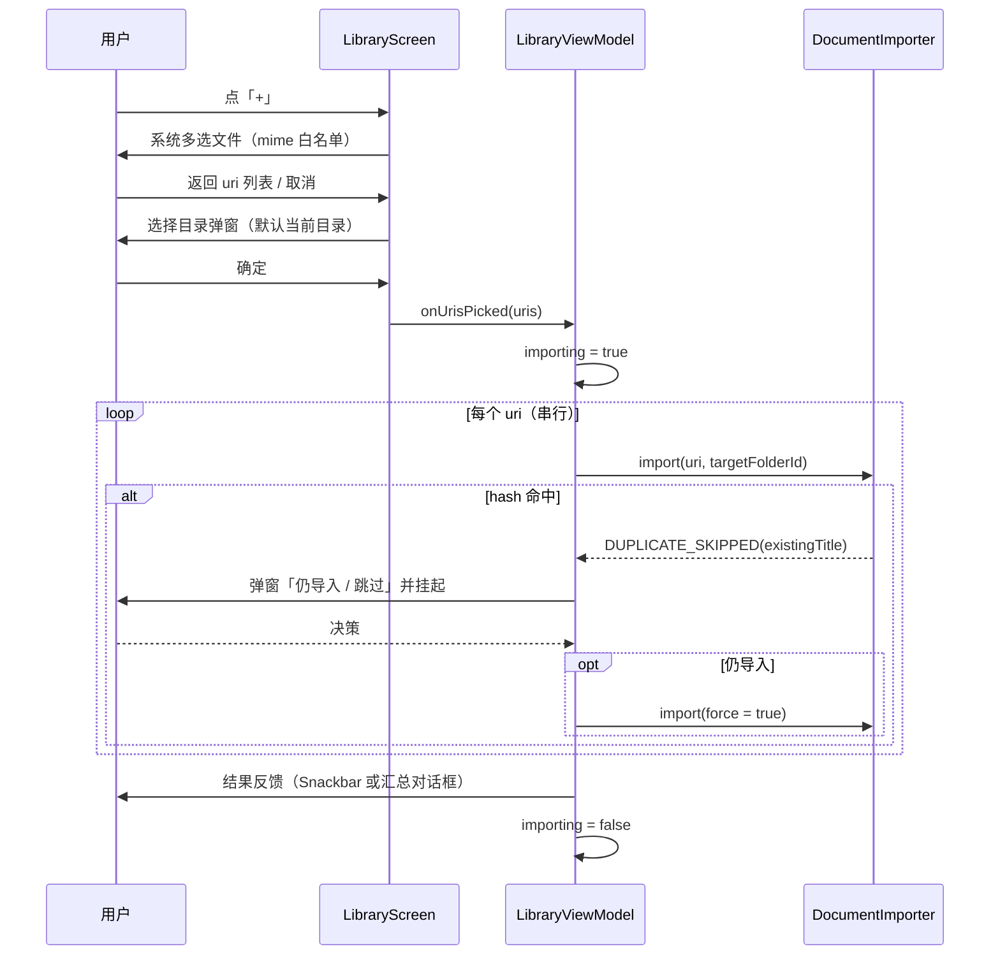

# 流程 · 单文件 / 多选导入

- 状态：评审通过
- 优先级：P0（D5 汇总对话框，T4）
- 关联决策：D5
- 代码落点：`feature/library/LibraryScreen.kt`（launcher）、`LibraryViewModel.kt`（`importUris`）、`DocumentImporter.kt`、`ImportSummaryDialog.kt`（复用）

## 1. 目标与入口

用户从系统文件选择器选一个或多个文档，导入到指定目录；必须明确告知成功/加密/跳过/拒收/失败数量与原因（多选时）。

入口：书架顶栏 `+`（任意目录层级，默认导入到当前目录）。

## 2. 时序

## 3. 状态与反馈

| 阶段 | UI | 文案 |
|---|---|---|
| 选择文件 | 系统选择器 | — |
| 选择目标目录 | `FolderPickerDialog`（默认当前目录） | `dlg_pick_dir_title` |
| 导入中 | 底部胶囊 + 环，导入入口禁用 | `loading_import` |
| 重复文件 | 阻断弹窗（导入循环挂起） | `dlg_duplicate_*` |
| 加密文件 | 计入结果 | `已加密（打开时需密码）` |
| 损坏文件 | 计入结果 | `损坏被拒收` |
| 完成（单文件） | Snackbar | `ok_import_summary` |
| 完成（多选，D5） | 汇总对话框 | `ok_import_summary_title_multi` |

## 4. 结果反馈规则（D5 / T4）

1. **单文件或无失败**：Snackbar 一句汇总即可（轻量，不打断）。
2. **多选且存在失败/跳过/拒收**：改用汇总对话框，字段与目录导入同构：

| 字段 | 说明 |
|---|---|
| `imported` | 导入成功数 |
| `passwordMarked` | 已加密标记数 |
| `duplicateSkipped` | 重复跳过数（用户选择「跳过」） |
| `corruptRejected` | 损坏拒收数 |
| `unsupported` | 不支持格式数 |
| `tooLarge` | 超过单文件上限（目录导入专有，单文件导入恒 0） |
| `failed` | 其他失败数（空间不足/IO/插库） |
| `issues` | 逐条原因（≤50 条），格式 `· {文件名} —— {原因}` |
| `renamedForConflict` / `folders*` / `deepSkipped` / `truncated` / `inaccessibleDirs` | 单文件导入恒 0/不显示 |

3. 抽统一模型 `ImportReport`（`total/imported/passwordMarked/duplicateSkipped/corruptRejected/unsupported/failed/issues`），由 `ImportSummaryDialog` 渲染；目录导入的模型可映射到它（复用同一 UI）。
4. 全无结果（例如全部跳过且用户未确认）：Snackbar `err_nothing_imported`。

## 5. 校验与边界

| 校验 | 规则 | 失败表现 |
|---|---|---|
| 格式白名单 | 扩展名优先、mime 兜底；未登记直接拒收（不复制） | 计入 `unsupported` |
| mime 过滤器 | `application/pdf`、`application/epub+zip`、`application/x-cbz`、`application/vnd.comicbook+zip`、`application/oxps`、`application/vnd.ms-xpsdocument`、`text/plain` | 系统选择器不展示其他文件 |
| 空间 | `可用 - 文件大小 >= 16MB` | `err_storage_low` → `failed` |
| 内容查重 | 流式 SHA-256 命中已有文档 | 弹窗确认（非静默跳过） |
| 加密 | 打开验证抛 `PasswordRequired` | 入库标记 `needsPassword`，`pageCount = -1` |
| 损坏 | 打开验证抛 `CorruptDocument` | 拒收，删除半成品 |
| 单文件大小 | **无显式上限**（仅空间检查） | `[建议 P2]` 与目录导入统一（200MB）以免行为不一致 |

## 6. 异常与并发

- 导入进行中再次点击 `+`：入口已禁用，无并发导入。
- 单文件 IO 异常：计入 `failed`，继续下一个文件（不中断整批）。
- 取消目录选择：不导入，无提示。
- 用户在选择目标目录时按返回：等同取消。
- 重复确认期间离开页面：导入循环随 VM 存续，返回后弹窗仍在（`pendingDuplicate` 为 VM 状态）。

## 7. 无障碍

| 项 | 要求 |
|---|---|
| 进度胶囊 | `liveRegion`，文案变化可播报 |
| 汇总对话框 | 打开时焦点进入标题，明细可逐行朗读 |
| 重复弹窗 | 两个按钮语义明确（「仍导入」「跳过」），不用「确定」 |
| 触达 | 系统选择器由系统保证；应用内按钮 ≥ 48dp |

## 8. 验收场景

1. 单文件正常 PDF：底部胶囊短暂出现 → Snackbar「导入 1 个」→ 网格出现卡片；
2. 加密 PDF：导入后书架有锁角标；打开弹密码框；
3. 损坏 PDF：Snackbar 含「损坏被拒收 1 个」，书架无新增，`library/` 无残留半成品；
4. 重复文件：弹「文档已存在」→「跳过」不新增；再次导入选「仍导入」新增一条（独立 id）；
5. 多选 3 个（1 正常 + 1 损坏 + 1 重复跳过）：出现汇总对话框，计数逐项正确（T4 后）；
6. 空间不足（模拟）：计入 `failed`，提示为「存储空间不足」；
7. 不支持格式（系统选择器若允许）：计入 `unsupported`；
8. 导入中 `+` 置灰，重复点击无第二次导入；
9. 目标目录选择取消：无任何库变化。
