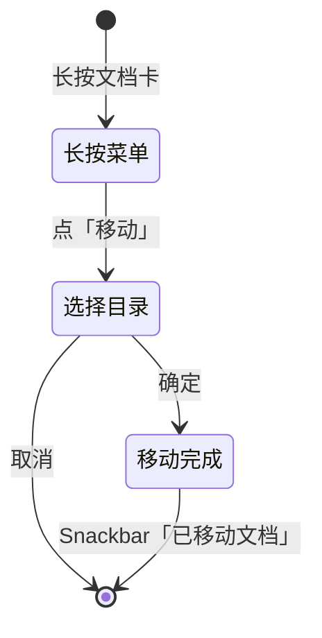

# 流程 · 移动、重命名与删除

- 状态：评审通过
- 优先级：P1（重名内联提示）/ P2（校验统一）
- 关联决策：D7（重名区分大小写）
- 代码落点：`LibraryScreen.kt`（编排）、`FolderPickerDialog.kt`、`OperationDialogs.kt`、`LibraryViewModel.kt`、`LibraryRepositoryImpl.kt`

## 1. 目标

在不破坏数据的前提下整理文档与目录；所有破坏性操作必须先说明后果。

## 2. 移动文档



- 目标可选任意目录（含根），默认选中当前目录。
- 目标 == 当前目录：不写库，Snackbar `文档已在该目录`。
- 仅改 `folderId`，**不移动物理文件**，`relPath` 不变。
- 移动成功后当前目录网格刷新；若目标为当前目录则不刷新。

## 3. 移动文件夹（防环）

1. 点击「移动」后先异步取 `subtree(id)`（自身 + 全部后代）。
2. 取集成功 → 打开选择器，`excludedIds = subtree`：
   - 选中禁选集内条目：行内红字 `err_move_cycle`，「确定」禁用；
   - 弹窗内新建的子目录若父在禁选集内，实时并入（避免快照绕过）。
3. 取集失败 → **不渲染选择器**，弹「无法移动 / 读取目录结构失败，请重试」。
4. 业务层 `moveFolder` 保留 `require` 兜底（UI 前置不是唯一防线）。

```
┌──────────────────────────┐
│ 选择目录                   │
│ → 根目录                   │
│ ▸ A                       │
│   ▸ B（选中，红字提示）      │
│ 不能移动到自身或其子目录      │
│            [取消] [确定(禁用)] │
└──────────────────────────┘
```

## 4. 重命名

| 对象 | 规则 | 副作用 |
|---|---|---|
| 文件夹 | trim 后非空；同父不重名（区分大小写，D7） | 仅改 `name` |
| 文档 | trim 后非空；同目录不重名；**扩展名锁定** | 仅改 `title`，不动 `relPath` / 物理文件 |

- 输入框预填旧名并全选；文档扩展名以 suffix 灰显，不可编辑。
- `[建议 T7]` 重名从 Snackbar 提升为输入期行内错误（`inline_name_duplicate`），按钮禁用。
- `[建议 T7]` 输入期限制 64 字符、过滤控制字符（与目录镜像规则统一）。

## 5. 删除

| 对象 | 后果文案 | 数据行为 |
|---|---|---|
| 文件夹 | 将删除文件夹「{name}」及其所有子目录，其中的文档将移至根目录。是否继续？ | 事务内：后代文档 `folderId → null`；子目录先于父删除 |
| 文档 | 将删除《{title}》，物理文件一并删除。是否继续？ | 删记录 + 删物理文件 + 缩略图 |

- 主按钮「删除」用 `error` 色；无输入确认。
- 删除成功后 Snackbar：文件夹 `已删除文件夹（其中文档已移至根目录）`；文档 `已删除文档`。
- 删除失败（IO/DB）：Snackbar `操作失败：{原因}`，界面保持原状。

## 6. 状态矩阵

| 状态 | 触发 | 展示 |
|---|---|---|
| 正常菜单 | 长按卡片 | 文件夹 4 项 / 文档 3 项 |
| 移动目标为当前 | 选中当前目录 | 确定可点，提交后提示"已在该目录" |
| 禁选目标 | 选自身/后代 | 红字 + 确定禁用 |
| 子树读取失败 | 异常 | 「无法移动」对话框，选择器不出现 |
| 重名 | 提交后（或输入期 T7） | Snackbar / 行内错误 |
| 删除中 | 提交后（瞬时） | 无进度；完成后 Snackbar |
| 目录被并发删除 | 提交时记录不存在 | Snackbar `操作失败：目录不存在` |

## 7. 校验规则

| 字段/操作 | 规则 | 时机 | 反馈 |
|---|---|---|---|
| 文件夹名 | trim 非空 | 输入期 | 创建/确定禁用 |
| 文件夹名 | 同父唯一（区分大小写） | 输入期（T7）/ 提交后 | 行内错误 / Snackbar |
| 文件夹名 | ≤64 字符、无控制字符 | 输入期（T7） | 行内提示 |
| 文档名 | trim 非空、扩展名锁定 | 输入期 | 确定禁用 |
| 文档名 | 同目录唯一 | 提交后 | Snackbar |
| 移动目标 | 不在禁选集 | 选中期 | 红字 + 确定禁用 |

## 8. 并发与一致性

- 所有写操作经 `launchOp` 串行执行，单次操作失败不影响后续。
- 移动/删除后依赖 Flow 自动刷新列表与面包屑，不做本地乐观更新（避免回滚复杂度）。
- 当前目录被删除时，面包屑回退「书架」、列表转空态，不崩溃。

## 9. 无障碍

| 项 | 要求 |
|---|---|
| 菜单替代 | `[建议 T5]` 卡片 `customActions` 提供重命名/移动/删除 |
| 禁选原因 | 红字文本需被朗读（`liveRegion`） |
| 删除后果 | 对话框正文完整朗读，不能只读标题 |
| 触达 | 菜单项 ≥ 48dp |

## 10. 验收场景

1. 移动文档到子目录：DB `folderId` 正确、`relPath` 不变、根网格移除；
2. 移动到当前目录：提示「文档已在该目录」，无写库；
3. 移动文件夹选自身/后代：红字提示且确定禁用；`[T7]` 弹窗内新建子目录仍禁选；
4. 子树读取失败（注入）：只弹「无法移动」，不出现选择器；
5. 重命名文档：扩展名不可编辑，输入新名后扩展名保留；同目录重名被拒；
6. 删除父目录：子目录全部删除、文档回根、Snackbar 文案正确；
7. 删除文档：物理文件与缩略图均删除（DB + 文件系统双向验证）；
8. 大小写不同的同名文件夹（如 `Docs` 与 `docs`）：允许创建（D7 语义），文档中已注明。
