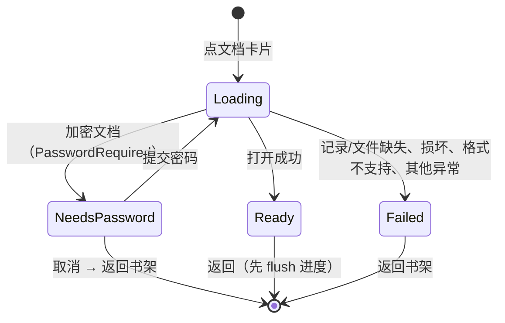

# 页面 · 阅读器

- 状态：评审通过
- 优先级：P0（D4 预研）/ P1（语义与重试）
- 关联决策：D4（沉浸模式独立预研）
- 路由：`reader/{documentId}`
- 代码落点：`feature/reader/ReaderScreen.kt`、`ReaderViewModel.kt`、`GoToPageDialog.kt`、`OutlineSheet.kt`；渲染 `feature/viewer-mupdf/*`、`feature/viewer-txt/*`

## 1. 目标

以最短路径进入阅读态并**准确恢复上次位置**；阅读中只保留必要控件（页码、目录、跳页、模式），不干扰内容。

## 2. 状态机



- `NeedsPassword → Loading` 产生**新 Ready 会话**：会话内状态（模式、当前页、浮层）全部重置，进度按新会话重新取。
- `Ready` 内部持有：`uiProgress`、`showOutline`、`showGoTo`、实时 `pageCount`。

## 3. 布局

### 3.1 水平分页 / 垂直滚动（共用顶栏）

```
┌────────────────────────────────────────────┐
│ [←] 文档标题（1 行省略）      [目录][跳页][模式] │
│     5 / 12                                 │
├────────────────────────────────────────────┤
│                                            │
│                 渲染区                      │
│      （水平：单页分页 / 垂直：连续滚动）        │
│                                            │
└────────────────────────────────────────────┘
```

- 渲染区不加额外 padding，铺满 `Scaffold` 内容区。
- 顶栏规格见 `components/top-bar.md` 第 2 节。
- 书签入口：动作区第 1 位（`[已实现 M10-C]`，实心/描边表示当前页已收藏）。

### 3.2 浮层

| 浮层 | 形态 | 触发 | 关闭 |
|---|---|---|---|
| 大纲 | `ModalBottomSheet` | 顶栏「目录」 | 下滑/点外部/选条目跳页 |
| 跳页 | `AlertDialog` | 顶栏「跳页」 | 取消/跳转 |
| 密码 | `AlertDialog` | 打开加密文档 | 取消=返回书架 / 打开 |
| 书签（M10） | `ModalBottomSheet` | 顶栏「书签」 | 下滑/点外部 |

同一时刻只允许一个浮层。

## 4. 交互细则

### 4.1 进度

1. 翻页/滚动 → 顶栏页码**立即**更新；
2. 静止 600ms 落库；`ON_PAUSE` / `ON_STOP` / 离开组合时立即 flush；
3. 恢复：以库中进度为初值组合视图，恢复期抑制首帧 `(0,0)` 回流；
4. 外部跳页：写入 `uiProgress`，offset 归 0（顶部对齐）；防回环由渲染端守卫；
5. 水平模式只记页码（offset 恒 0）；垂直记页码 + 像素偏移；epub 记 CFI（页码为展示近似值）。

**用户可见承诺**：按返回后立即重进，位置不变；旋转/分屏后位置保持（epub 页码数字可能变化但位置等义）。

### 4.2 跳页

- 打开时预填当前页（1 基）。
- 输入：仅数字、≤7 位、范围 `1..pageCount`；越界时 `isError` + 跳转禁用。
- 跳转：写 `uiProgress`（offset 0）；页码式立即可见，流式由渲染端回发 CFI 落库。
- 大纲跳页同样的 clamp 规则（越界页码不落库）。

### 4.3 大纲

- 打开时懒加载，加载中「正在加载目录…」+ 环；
- 空：「本文档没有目录」；
- 失败：「目录加载失败」+「重试」（`[已实现 T6]`，重试重走加载）；
- 展平缩进（每级 20dp），条目 1 行省略，key 用序号（PDF 大纲允许同名同页重复）；
- 点击条目：跳页并关闭面板。

### 4.4 模式切换

- 顶栏按钮切换水平/垂直，**会话态**，不回写设置偏好；
- 保持当前页：H→V 停在当前页顶部；V→H 丢弃 offset 定位当前页；
- epub 打开时默认强制垂直（仍可临时切水平）。

### 4.5 返回

- 返回前 flush 进度（`DisposableEffect` + 生命周期观察者双保险）；
- 密码框取消：先让弹窗离开组合再导航（避免残影）。

## 5. 失败页

```
┌────────────────────────────┐
│                            │
│   无法读取此文档（可能已损坏）  │  error 色 bodyLarge
│                            │
│        [返回书架]            │
│        [重试]（建议）         │
└────────────────────────────┘
```

失败原因与文案（逐字）：

| reason | 文案键 | 现状 |
|---|---|---|
| 记录缺失 | `err_missing_record` | `[已实现]` |
| 文件缺失 | `err_missing_file` | `[已实现]` |
| 损坏 | `err_corrupt_open` | `[已实现]` |
| 格式不支持 | `err_unsupported_type` | `[已实现 T6]`（已去 `fileType` 技术值） |
| 其他 | `err_open_generic` | `[已实现]` |

`[建议 P2]`：增加「重试」；MISSING 记录场景增加「删除此记录」。

## 6. 沉浸模式（D4：已实现并真机验收通过）

目标：垂直长文档阅读时释放顶栏 64dp。

### 6.1 预研结论（代码实证）

| 通道 | 事实 | 结论 |
|---|---|---|
| 水平分页 | 上游 `ReaderView` 自己消费触摸：`onTouchEvent` 交给 `GestureDetector` / `ScaleGestureDetector`；`onSingleTapUp` 中**边缘 `tapPageMargin`（约 1 英寸，钳 100px ~ 屏宽/5）→ 翻页**，**中间区域 → `onTapMainDocArea()`（protected 空钩子）**；`onScroll` 中调 `onDocMotion()`（同为 protected 空钩子） | **不要用 Compose 手势**：AndroidView 区域的事件交给内部 View，外层 `pointerInput` 收不到稳定事件。改为覆写上游钩子：`onTapMainDocArea()` → 切换顶栏；`onDocMotion()` → 隐藏顶栏 |
| 垂直滚动（MuPDF） | `MuPdfVerticalView` 的 `LazyColumn` 无任何点击/手势处理 | 外层 `pointerInput { detectTapGestures(onTap = …) }` 可行；滚动会取消 tap，**无冲突** |
| 连续滚动（TXT） | `TxtViewerProvider` 同为裸 `LazyColumn` | 同上 |
| 边缘点按 | 水平边缘区仍翻页，且不唤出顶栏 | 符合直觉，作为设计约定保留（避免"想翻页却唤出工具栏"） |

### 6.2 交互契约（实现时照此执行）

1. 进入阅读器：顶栏显示。
2. 点按内容区中间区域（水平 = 非边缘 1 英寸；垂直 = 未滚动的任意点按）→ 切换顶栏显隐。
3. 拖动 / 滚动 / 缩放 → 顶栏隐藏（水平用 `onDocMotion`；垂直监听滚动状态或手势取消）。
4. 大纲 / 跳页操作完成后 → 顶栏显示（用户刚操作，需要页码反馈）。
5. 隐藏时**仅隐藏应用内 TopAppBar**，不改系统状态栏 / 导航栏（避免 insets 抖动与手势导航冲突）。
6. 隐藏不改变返回语义：系统返回仍退出阅读器。

### 6.3 无障碍强制约束（不满足则不实现）

| 约束 | 原因 |
|---|---|
| `AccessibilityManager.isTouchExplorationEnabled == true` 时**禁用自动隐藏** | 读屏探索触摸会误触隐藏并丢失焦点 |
| 隐藏态必须暴露语义动作 `Modifier.semantics { onClick(label = "显示工具栏") { …; true } }` | 读屏用户需双击内容区唤出顶栏；纯 `pointerInput` 不产生 click 语义 |
| 顶栏隐藏后动作全部不可达，必须保留可读的恢复路径 | 防止"无出口" |

### 6.4 实现工作量与契约变更

沿用 T3 `onPageCountChanged` 的契约扩展先例，`DocumentViewerProvider.Content` 追加两个回调（**不带默认值**——接口注释明确「Compose 接口默认参数 + 实现会生成冲突重载桥」，全 6 个实现点同步签名）：

```kotlin
onTapContent: () -> Unit,
onUserScroll: () -> Unit,
```

- 实现侧：`MuPdfReaderView`（覆写 `onTapMainDocArea` / `onDocMotion`，经 `rememberUpdatedState` 转发）、`MuPdfVerticalView`、`TxtViewerProvider`（`pointerInput` + `detectTapGestures` + `isScrollInProgress` 监听）。
- 状态侧：`ReaderScreen` 持有 `topBarVisible`（`rememberSaveable`，旋转保持）；顶栏以 **overlay 浮层 + `fadeIn`/`fadeOut`** 呈现——内容区尺寸恒定不 relayout（显隐不闪），`TopAppBar` 半透明背景（`surface` 92% alpha）+ `windowInsets(0)` 减轻遮挡感；隐藏态语义动作 `onClick(label="显示工具栏")` 落在内容区 `Box`。大纲/跳页关闭时置 `true`。
- 测试侧：4 个 fake 签名同步；`ReaderViewModelTest` 无需改（状态在 Screen 层）。
- 预估：1 个会话（含真机验收）。

### 6.5 验收场景

1. 水平 PDF 点中间 → 顶栏隐藏；再点 → 显示；点左右边缘 → 翻页且顶栏状态不变；
2. 水平拖动翻页 → 顶栏隐藏；
3. 垂直滚动 → 隐藏；静止后点按 → 显示；
4. 大纲跳页 → 顶栏可见（页码反馈可读）；
5. 开启 TalkBack → 滚动不自动隐藏；双击内容区可切换顶栏；
6. 旋转 / 分屏 → 显隐状态保持，渲染不白屏；
7. 字体 200% / 深色 → 顶栏淡入淡出、内容区尺寸恒定（显隐前后渲染区 bounds 完全一致，不 relayout 不闪）。

## 7. 书签（`[已实现 M10-C]`）

- 入口：顶栏第 1 个动作（`Bookmark`/`BookmarkBorder` 区分当前页是否已收藏）；面板形态复用 `OutlineSheet`；
- 内容：当前文档书签列表（章节级，按页码升序/同页时间倒序），点击跳转，行尾删除图标（替代长按，读屏可直达），顶部「添加当前位置书签」；
- 空态：`empty_bookmarks`（暂无书签）+ 顶部添加入口；加载失败给「重试」；
- 交互细则与实现差异见 `flows/bookmark-m10.md`（§8）；持久化与迁移以 `docs/m10-plan.md` 为准。

## 8. 高亮与笔记（`[已实现 M12-B]`）

- 入口：顶栏「标注」双 Tab 面板（`AnnotationHubSheet`，书签 + 高亮合并，见 §7）；高亮创建入口为**长按选中文本**（区别于单击切换顶栏 / 水平边缘翻页 / 垂直滚动）。
- 选择与操作（M14 改）：水平 `MuPdfReaderView` 长按进入选择、拖动扩展，垂直 `MuPdfVerticalView` 用 `detectDragGesturesAfterLongPress` 选择；松手**上报 `TextSelectionEvent`（归一化 `AnnotationDraft` + 屏幕锚点）并弹出操作气泡**（朗读 / 高亮 / 复制），不再直接落库。「高亮」动作才创建原生 `PDFAnnotation.TYPE_HIGHLIGHT`（水平）/ 自绘半透明黄 overlay（垂直，画在位图之上）。
- 面板：`AnnotationSection` 列表展示页码 / 摘录（60 字截断）/ 时间 / 色点，点击跳转、尾部删除；点击已有高亮经 `AnnotationNoteDialog` 加/改笔记（空串即清空）；`AnnotationColorDialog` 5 色（`ANNOTATION_COLORS`，默认黄），水平按 `argbToRgb` 原生重放、垂直 `drawQuadPath` 自绘按色（alpha 0.35）。
- 持久化：`annotations` 表（Room v3）+ 归一化 quad 锚点（`AnnotationAnchorCodec`），跨会话回放；随备份 v4 导出/恢复。见 `docs/data-layer.md`「标注存储」、`docs/m12-plan.md`。
- 已知限制（已拍板不做）：epub 水平模式自绘 overlay、归一化 quad 跨重排页级近似提升。

### 8.1 文本朗读与复制（`[已实现 M14]`）

- 入口：选中文本松手弹出的操作气泡（`SelectionMenu`，`Popup` 悬浮在选中锚点旁，20dp 圆角 + 对白框尾巴，锚点太靠上时翻转到下方）。
- 朗读：系统 `TextToSpeech`，朗读前按 `detectLanguage`（含汉字 → `zh-CN`，否则 `en-US`）选语音包；语音包缺失/不支持弹 Snackbar「未找到语音包，请在系统设置中下载」。TTS 会话内持有一份，退出 `shutdown`；再次朗读 `QUEUE_FLUSH` 打断上一段。
- 复制：`LocalClipboardManager` 写剪贴板 + Snackbar「已复制」。
- 图标（material-icons-extended）：朗读 `RecordVoiceOver`、高亮 `Brush`、复制 `ContentCopy`。
- 已知限制：朗读内容 = 手动选中文本（非自动句子吸附）；语言检测按「是否含汉字」二分（混排整段走中文）；依赖设备语音包。

### 8.2 选中文本视觉反馈（`[已实现 M14·v3 微信读书式 2026-11-16]`）

> v3 定稿：深色菜单条（#2C2C2C + 白色三动作：朗读/高亮/复制 + 弧形鱼尾指针）+ 泪滴手柄（尖朝上贴选区下沿，主体沉入下方便于抓握）+ 主题色选区。手柄位于选区下沿、菜单悬于选区上方，三者空间分离，彻底解决「手柄压字 / 与菜单重叠」。菜单居中于选区（锚点改为选区中心 X），出屏 clamp，上方空间不足翻转到下方。（「更多」扩展位因暂无功能已移除，后续接入实际功能再加回。）
>
> **拖手柄收起菜单**：S2a 拖动期间菜单隐藏、松手在新位置重弹（`onSelectionAdjusting(Boolean)` 回调驱动，真机验证：拖动中菜单深色像素 136、松手后 19050）。
> **深色主题对比度**：PDF 内容不反色（白底），菜单条 `#2C2C2C` 其上实测对比 6.15:1（WCAG 非文本 3:1 达标）；页面外深色背景区域对比 2.65:1（边缘情况，记录不处理）。

> 实现状态：选中显示 / 手柄绘制 / 手柄拖动 / 点外部清除全链路真机验收通过（水平 PDF 与垂直 EPUB 双路径）；手柄带 a11y `contentDescription`（「调整选区起点/终点」）。实现要点：①水平手柄/选区在 `dispatchDraw` 之后绘制（ViewGroup `onDraw` 会被 PageView 位图覆盖——修复 M12 起拖动预览实际不可见的历史缺陷）；②气泡非聚焦 Popup（focusable 会全屏拦截外部触摸），且忽略 `onDismissRequest`（部分版本非聚焦仍会因外部触摸回调，造成「点选区内也应保持」被误清的双重清空）；③点选区内部（非手柄）保持选中、点选区外才清除（四边形精确包含判断）；④垂直手柄 Compose 化（Box + pointerInput + semantics），拖动复用 `selectQuads`/`selQuads` 链路。遗留：深色主题选区可读性专项调优、水平手柄 a11y（Canvas 绘制，需 AccessibilityDelegate）、临时选区与已存高亮叠加观感。

> 动机：M12 松手即落库高亮，选中内容天然有黄色反馈；M14 改为松手弹气泡（不落库），渲染端松手即清空选区预览，导致「选中后看不到选中内容」。本设计参考微信读书「长按选词 → 两端手柄 → 拖手柄精确选区 → 弹菜单」的交互，定义选中文本的完整视觉反馈与状态机，取代「把选中草稿塞进 `annotations` 回放」的临时做法（缺陷：①临时/持久语义混淆；②临时选区复用高亮黄，与已保存高亮无法区分）。

#### 8.2.1 状态模型（四态）

| 状态 | 名称 | 触发 | 视觉 | 结束 |
|---|---|---|---|---|
| S1 选择中 | selecting | 长按进入，拖动扩展 | `primary` 半透明预览，跟随手指 | 松手 |
| S2 已选中 | selected | 松手，手柄 + 气泡 | `primary` 半透明定格 + 两端手柄 + 气泡菜单 | 动作 / 取消 / 拖手柄 / 翻页 |
| S2a 拖手柄 | adjusting | 拖动起点/终点手柄 | 预览随手指扩展，对端手柄固定 | 松手手柄 → 回 S2 |
| S3 已高亮 | highlighted | 点「高亮」落库 | 高亮色板实色填充（持久标注） | 删除高亮 |

#### 8.2.2 颜色与表现语义（选区与高亮必须可辨识）

- **选区（S1/S2）**：`MaterialTheme.colorScheme.primary`，约 25% 不透明度（`copy(alpha = 0.25f)`）—— 浅色主题深紫、深色主题浅紫，随主题一致；语义「这是选中范围，尚未保存」。
- **选择手柄**：`primary` 实色圆点 + 白描边（见 §8.2.3）—— 语义「可拖动调整选区」。
- **标注（S3）**：`ANNOTATION_COLORS` 色板（黄/绿/蓝/粉/橙，默认黄 `#FFEB3B`）—— 语义「这是已保存的标注」。

**两个维度同时区分，杜绝混淆**：
1. **色相**：选区用主题 `primary`（紫色系，Material3 默认），高亮用固定彩色色板（黄/绿/蓝/粉/橙）—— 色系不同；
2. **表现**：选区为**半透明浅罩层**（25% 透明，文字清晰可读），高亮为**实色填充**（文字背景被着色）。

设计意图：S1→S2 同色（松手无跳变）；S2→S3 从「主题色浅罩」变为「高亮实色块」，保存反馈强烈，未保存 / 已保存一眼可辨。

> 现状注：S3 水平原生 annotation 为 100% 不透明、垂直自绘 `alpha=0.35`，此不一致为 M12 遗留，本设计不扩大（如需统一另行决策）。

#### 8.2.3 选择手柄规格（竖线手柄）

> 问题（真机反馈）：圆形手柄圆心落在选区首尾字符中点，**压住选中文字**。改为**竖线手柄**——竖线贴在选区边界（字符间隙），天然不遮挡文字，无需偏移/翻转。

- **外观（竖线 + 上下端点）**：竖直短条（宽 3dp，`primary` 填充）+ 上下各一个端点小圆（直径 6dp，`primary` 填充 + `Color.White` 1dp 描边）；整体「哑铃」形，增强可拖动暗示。
- **定位（关键）**：起点手柄竖线中心贴**首 quad 左缘**、终点手柄竖线中心贴**末 quad 右缘**；竖线纵向覆盖该行文本高度（`ul_y→ll_y` / `ur_y→lr_y`）。竖线位于字符间隙，**不压字**。
- **触达**：命中判定以竖线为中心、宽 24dp 高 48dp 的矩形（拖动语义，放宽于 tokens 48dp 静止触达的边长、但高度达 48dp 便于抓取）。
- **交互**：拖动竖线 → 对应边界跟随手指、吸附词边界实时重算；对端不动；松手回 S2 并重弹菜单。
- **手势共存**：长按后原地继续拖动等价于拖终点手柄；轻点竖线拖动精确调整。

**实现影响**（待落地）：水平 `drawHandles` / 垂直 `SelectionHandle` 由圆形改为「竖线 + 两端点」绘制；命中检测由「圆心半径」改为「竖线中心矩形」；拖动映射边界点从竖线 x 坐标反解。

#### 8.2.4 交互契约（状态转换表）

| 从 | 事件 | 到 | 视觉变化 |
|---|---|---|---|
| 无 | 长按 | S1 | `primary` 半透明预览出现 |
| S1 | 拖动 | S1 | 预览跟随扩展 |
| S1 | 松手 | S2 | 预览定格 + 两端手柄 + 气泡 |
| S2 | 拖手柄 | S2a | 菜单收起，预览随手指扩展 |
| S2a | 松手手柄 | S2 | 预览定格 + 菜单重弹 |
| S2 | 朗读 / 复制 | 无 | 气泡关 + 预览与手柄清除 |
| S2 | 高亮 | S3 | 气泡关 + 预览/手柄替换为高亮实色（落库） |
| S2 | 点击气泡外 | 无 | 气泡关 + 预览与手柄清除 |
| S2 | 翻页 / 滚动 | 无 | 预览与手柄清除（选区上下文失效） |

#### 8.2.5 实现落点

- **临时选区（S1/S2/S2a）与持久高亮（S3）分通道**：
  - S3 持久高亮：现有 `annotations` 回放，用高亮色板。
  - 临时选区 + 手柄：渲染端「选区预览」机制，用主题色，松手保留、气泡关闭清除。
- 选中态提升到 `ReaderScreen`：`Content` 新增 `activeSelection: AnnotationDraft?`（当前选中草稿，null=无），渲染端按其 quads 绘制预览 + 手柄；气泡关闭置 null 触发清除。
- **主题色获取（关键技术点）**：水平模式是 `AndroidView`（`ReaderView`），其 `onDraw` 不在 Compose 上下文、无法直接读 `MaterialTheme.colorScheme`——需在 Compose 层取 `primary` 后经 `update` 块传入（更新 `selPaint` 与手柄画笔），或把手柄/预览改为 Compose overlay（在 `AndroidView` 之上叠加）。垂直模式本就 Compose 绘制，直接取 `colorScheme.primary`。
- 拖手柄的坐标换算复用现有 `scaleOf()` / `positionInWindow` 逻辑；词边界吸附复用 `MuPDFCore.selectText` 的 `snapSelection(SELECT_WORDS)`。

#### 8.2.6 无障碍与主题

- 手柄为可拖动控件，提供 `contentDescription`（「调整选区起点」「调整选区终点」）；TalkBack 完整拖动操作列为 P2（MVP 读屏可感知手柄存在）。
- 选区色随主题 `primary`，作用于白色内容层之上，内容不反色，深浅主题下均清晰（与「渲染内容不反色」一致，tokens §10）。

#### 8.2.7 验收

1. 长按选中词 → 松手 → `primary` 半透明预览 + 两端手柄 + 气泡，颜色随主题；
2. 拖终点手柄 → 选区扩展、菜单收起；松手 → 菜单重弹；
3. 点「朗读/复制」→ 气泡关 + 预览与手柄清除（未落库位置无残留）；
4. 点「高亮」→ 预览/手柄替换为高亮实色 + Snackbar「已添加高亮」；
5. 点气泡外 / 翻页 → 预览与手柄清除；
6. 水平 PDF / 垂直 EPUB 双路径一致；深浅主题下选区色随 `primary` 变化、高亮色不变。

## 9. 无障碍

| 项 | 要求 | 现状 |
|---|---|---|
| 页码朗读 | 「第 5 页，共 12 页」 | `[缺口 T5]` |
| 进度环语义 | `stateDescription = "正在加载"` | `[缺口 T5]` |
| 失败页 | 文案 `liveRegion`，按钮可直达 | `[建议 T5]` |
| 大纲条目 | 层级可感知 | `[建议 P2]` |
| 密码框 | 错误提示被朗读 | `[建议]` `liveRegion` |
| 触达 | 顶栏动作 48dp | `[已实现]` |

## 10. 响应式

| 场景 | 变化 |
|---|---|
| 旋转/分屏 | 渲染重建；epub 重排并更新分母；进度保持 |
| 水平超宽屏 | 单页居中，不拉伸变形（`ReaderView` 自适应） |
| 垂直滚动 | 页宽随屏宽，位图按宽度缓存；跨宽度恢复偏移有近似误差 |
| 字体 200% | 顶栏双行标题不裁切（1 行省略） |
| 深色 | 渲染内容不反色，仅 UI 主题变化 |

## 11. 验收场景

1. 打开 12 页 PDF：顶栏 `1 / 12`；滑到第 5 页 → 返回 → 重进为 `5 / 12`；
2. 跳页输入 `0`/`99`/字母：过滤与禁用符合规则；输入 `8` 跳到第 8 页；
3. 大纲：加载态 → 列表；点击「Section 1.2」跳至第 4 页；
4. 快速开关大纲 6 次：不出现「目录加载失败」；
5. 加密 PDF：密码框，空不可提交，错误密码内联提示且内容保留，正确密码后渲染并回填页数/缩略图；
6. 旋转竖→横→竖：位置保持，无白屏；
7. epub 水平：分母随重排变化，跳页范围同步；
8. 垂直滚至第 5 页 → BACK → 设置默认垂直 → 重进直接垂直恢复且页码正确；
9. 损坏文件：失败页文案 + 返回书架可用；
10. 顶栏动作在 360dp 下不溢出（含 M10 书签入口后的重新验证）。
