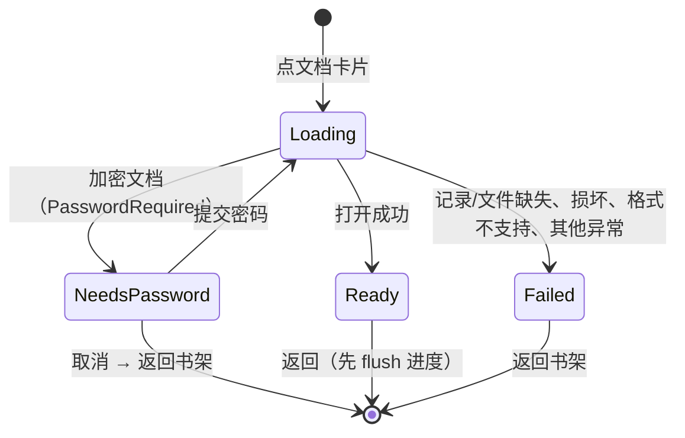

# 页面 · 阅读器

- 状态：评审通过
- 优先级：P0（D4 预研）/ P1（语义与重试）
- 关联决策：D4（沉浸模式独立预研）
- 路由：`reader/{documentId}`
- 代码落点：`feature/reader/ReaderScreen.kt`、`ReaderViewModel.kt`、`GoToPageDialog.kt`、`OutlineSheet.kt`；渲染 `feature/viewer-mupdf/*`、`feature/viewer-txt/*`

## 1. 目标

以最短路径进入阅读态并**准确恢复上次位置**；阅读中只保留必要控件（页码、目录、跳页、模式），不干扰内容。

## 2. 状态机



- `NeedsPassword → Loading` 产生**新 Ready 会话**：会话内状态（模式、当前页、浮层）全部重置，进度按新会话重新取。
- `Ready` 内部持有：`uiProgress`、`showOutline`、`showGoTo`、实时 `pageCount`。

## 3. 布局

### 3.1 水平分页 / 垂直滚动（共用顶栏）

```
┌────────────────────────────────────────────┐
│ [←] 文档标题（1 行省略）      [目录][跳页][模式] │
│     5 / 12                                 │
├────────────────────────────────────────────┤
│                                            │
│                 渲染区                      │
│      （水平：单页分页 / 垂直：连续滚动）        │
│                                            │
└────────────────────────────────────────────┘
```

- 渲染区不加额外 padding，铺满 `Scaffold` 内容区。
- 顶栏规格见 `components/top-bar.md` 第 2 节。
- M10 书签入口预留：动作区第 1 位。

### 3.2 浮层

| 浮层 | 形态 | 触发 | 关闭 |
|---|---|---|---|
| 大纲 | `ModalBottomSheet` | 顶栏「目录」 | 下滑/点外部/选条目跳页 |
| 跳页 | `AlertDialog` | 顶栏「跳页」 | 取消/跳转 |
| 密码 | `AlertDialog` | 打开加密文档 | 取消=返回书架 / 打开 |
| 书签（M10） | `ModalBottomSheet` | 顶栏「书签」 | 下滑/点外部 |

同一时刻只允许一个浮层。

## 4. 交互细则

### 4.1 进度

1. 翻页/滚动 → 顶栏页码**立即**更新；
2. 静止 600ms 落库；`ON_PAUSE` / `ON_STOP` / 离开组合时立即 flush；
3. 恢复：以库中进度为初值组合视图，恢复期抑制首帧 `(0,0)` 回流；
4. 外部跳页：写入 `uiProgress`，offset 归 0（顶部对齐）；防回环由渲染端守卫；
5. 水平模式只记页码（offset 恒 0）；垂直记页码 + 像素偏移；epub 记 CFI（页码为展示近似值）。

**用户可见承诺**：按返回后立即重进，位置不变；旋转/分屏后位置保持（epub 页码数字可能变化但位置等义）。

### 4.2 跳页

- 打开时预填当前页（1 基）。
- 输入：仅数字、≤7 位、范围 `1..pageCount`；越界时 `isError` + 跳转禁用。
- 跳转：写 `uiProgress`（offset 0）；页码式立即可见，流式由渲染端回发 CFI 落库。
- 大纲跳页同样的 clamp 规则（越界页码不落库）。

### 4.3 大纲

- 打开时懒加载，加载中「正在加载目录…」+ 环；
- 空：「本文档没有目录」；
- 失败：「目录加载失败」+ `[建议]` 重试按钮；
- 展平缩进（每级 20dp），条目 1 行省略，key 用序号（PDF 大纲允许同名同页重复）；
- 点击条目：跳页并关闭面板。

### 4.4 模式切换

- 顶栏按钮切换水平/垂直，**会话态**，不回写设置偏好；
- 保持当前页：H→V 停在当前页顶部；V→H 丢弃 offset 定位当前页；
- epub 打开时默认强制垂直（仍可临时切水平）。

### 4.5 返回

- 返回前 flush 进度（`DisposableEffect` + 生命周期观察者双保险）；
- 密码框取消：先让弹窗离开组合再导航（避免残影）。

## 5. 失败页

```
┌────────────────────────────┐
│                            │
│   无法读取此文档（可能已损坏）  │  error 色 bodyLarge
│                            │
│        [返回书架]            │
│        [重试]（建议）         │
└────────────────────────────┘
```

失败原因与文案（逐字）：

| reason | 文案键 | 现状 |
|---|---|---|
| 记录缺失 | `err_missing_record` | `[已实现]` |
| 文件缺失 | `err_missing_file` | `[已实现]` |
| 损坏 | `err_corrupt_open` | `[已实现]` |
| 格式不支持 | `err_unsupported_type` | `[已实现]`（含原始 `fileType`，`[建议]` 去技术值） |
| 其他 | `err_open_generic` | `[已实现]` |

`[建议 P2]`：增加「重试」；MISSING 记录场景增加「删除此记录」。

## 6. 沉浸模式（D4：预研完成，结论=可行，待排期）

目标：垂直长文档阅读时释放顶栏 64dp。

### 6.1 预研结论（代码实证）

| 通道 | 事实 | 结论 |
|---|---|---|
| 水平分页 | 上游 `ReaderView` 自己消费触摸：`onTouchEvent` 交给 `GestureDetector` / `ScaleGestureDetector`；`onSingleTapUp` 中**边缘 `tapPageMargin`（约 1 英寸，钳 100px ~ 屏宽/5）→ 翻页**，**中间区域 → `onTapMainDocArea()`（protected 空钩子）**；`onScroll` 中调 `onDocMotion()`（同为 protected 空钩子） | **不要用 Compose 手势**：AndroidView 区域的事件交给内部 View，外层 `pointerInput` 收不到稳定事件。改为覆写上游钩子：`onTapMainDocArea()` → 切换顶栏；`onDocMotion()` → 隐藏顶栏 |
| 垂直滚动（MuPDF） | `MuPdfVerticalView` 的 `LazyColumn` 无任何点击/手势处理 | 外层 `pointerInput { detectTapGestures(onTap = …) }` 可行；滚动会取消 tap，**无冲突** |
| 连续滚动（TXT） | `TxtViewerProvider` 同为裸 `LazyColumn` | 同上 |
| 边缘点按 | 水平边缘区仍翻页，且不唤出顶栏 | 符合直觉，作为设计约定保留（避免"想翻页却唤出工具栏"） |

### 6.2 交互契约（实现时照此执行）

1. 进入阅读器：顶栏显示。
2. 点按内容区中间区域（水平 = 非边缘 1 英寸；垂直 = 未滚动的任意点按）→ 切换顶栏显隐。
3. 拖动 / 滚动 / 缩放 → 顶栏隐藏（水平用 `onDocMotion`；垂直监听滚动状态或手势取消）。
4. 大纲 / 跳页操作完成后 → 顶栏显示（用户刚操作，需要页码反馈）。
5. 隐藏时**仅隐藏应用内 TopAppBar**，不改系统状态栏 / 导航栏（避免 insets 抖动与手势导航冲突）。
6. 隐藏不改变返回语义：系统返回仍退出阅读器。

### 6.3 无障碍强制约束（不满足则不实现）

| 约束 | 原因 |
|---|---|
| `AccessibilityManager.isTouchExplorationEnabled == true` 时**禁用自动隐藏** | 读屏探索触摸会误触隐藏并丢失焦点 |
| 隐藏态必须暴露语义动作 `Modifier.semantics { onClick(label = "显示工具栏") { …; true } }` | 读屏用户需双击内容区唤出顶栏；纯 `pointerInput` 不产生 click 语义 |
| 顶栏隐藏后动作全部不可达，必须保留可读的恢复路径 | 防止"无出口" |

### 6.4 实现工作量与契约变更

沿用 T3 `onPageCountChanged` 的契约扩展先例，`DocumentViewerProvider.Content` 追加两个带默认值的回调（全实现与测试 fake 同步）：

```kotlin
onTapContent: () -> Unit = {},
onUserScroll: () -> Unit = {},
```

- 实现侧：`MuPdfReaderView`（覆写 `onTapMainDocArea` / `onDocMotion`，经 `rememberUpdatedState` 转发）、`MuPdfVerticalView`、`TxtViewerProvider`（`pointerInput` + `semantics`）。
- 状态侧：`ReaderScreen` 持有 `topBarVisible`（`rememberSaveable`，旋转保持）；大纲/跳页关闭时置 `true`。
- 测试侧：4 个 fake 签名同步；`ReaderViewModelTest` 无需改（状态在 Screen 层）。
- 预估：1 个会话（含真机验收）。

### 6.5 验收场景

1. 水平 PDF 点中间 → 顶栏隐藏；再点 → 显示；点左右边缘 → 翻页且顶栏状态不变；
2. 水平拖动翻页 → 顶栏隐藏；
3. 垂直滚动 → 隐藏；静止后点按 → 显示；
4. 大纲跳页 → 顶栏可见（页码反馈可读）；
5. 开启 TalkBack → 滚动不自动隐藏；双击内容区可切换顶栏；
6. 旋转 / 分屏 → 显隐状态保持，渲染不白屏；
7. 字体 200% / 深色 → 显隐切换无布局跳动（内容区尺寸恒定）。

## 7. 书签（M10 预留）

- 入口：顶栏第 1 个动作；面板形态复用 `OutlineSheet`；
- 内容：当前文档书签列表（章节级），点击跳转，长按/侧滑删除，顶部「添加当前页书签」；
- 空态：`empty_bookmarks` + 新建入口；
- 持久化与迁移以 `docs/m10-plan.md` 为准（本文件只定义交互，冲突时服从执行计划）。

## 8. 无障碍

| 项 | 要求 | 现状 |
|---|---|---|
| 页码朗读 | 「第 5 页，共 12 页」 | `[缺口 T5]` |
| 进度环语义 | `stateDescription = "正在加载"` | `[缺口 T5]` |
| 失败页 | 文案 `liveRegion`，按钮可直达 | `[建议 T5]` |
| 大纲条目 | 层级可感知 | `[建议 P2]` |
| 密码框 | 错误提示被朗读 | `[建议]` `liveRegion` |
| 触达 | 顶栏动作 48dp | `[已实现]` |

## 9. 响应式

| 场景 | 变化 |
|---|---|
| 旋转/分屏 | 渲染重建；epub 重排并更新分母；进度保持 |
| 水平超宽屏 | 单页居中，不拉伸变形（`ReaderView` 自适应） |
| 垂直滚动 | 页宽随屏宽，位图按宽度缓存；跨宽度恢复偏移有近似误差 |
| 字体 200% | 顶栏双行标题不裁切（1 行省略） |
| 深色 | 渲染内容不反色，仅 UI 主题变化 |

## 10. 验收场景

1. 打开 12 页 PDF：顶栏 `1 / 12`；滑到第 5 页 → 返回 → 重进为 `5 / 12`；
2. 跳页输入 `0`/`99`/字母：过滤与禁用符合规则；输入 `8` 跳到第 8 页；
3. 大纲：加载态 → 列表；点击「Section 1.2」跳至第 4 页；
4. 快速开关大纲 6 次：不出现「目录加载失败」；
5. 加密 PDF：密码框，空不可提交，错误密码内联提示且内容保留，正确密码后渲染并回填页数/缩略图；
6. 旋转竖→横→竖：位置保持，无白屏；
7. epub 水平：分母随重排变化，跳页范围同步；
8. 垂直滚至第 5 页 → BACK → 设置默认垂直 → 重进直接垂直恢复且页码正确；
9. 损坏文件：失败页文案 + 返回书架可用；
10. 顶栏动作在 360dp 下不溢出（含 M10 书签入口后的重新验证）。
