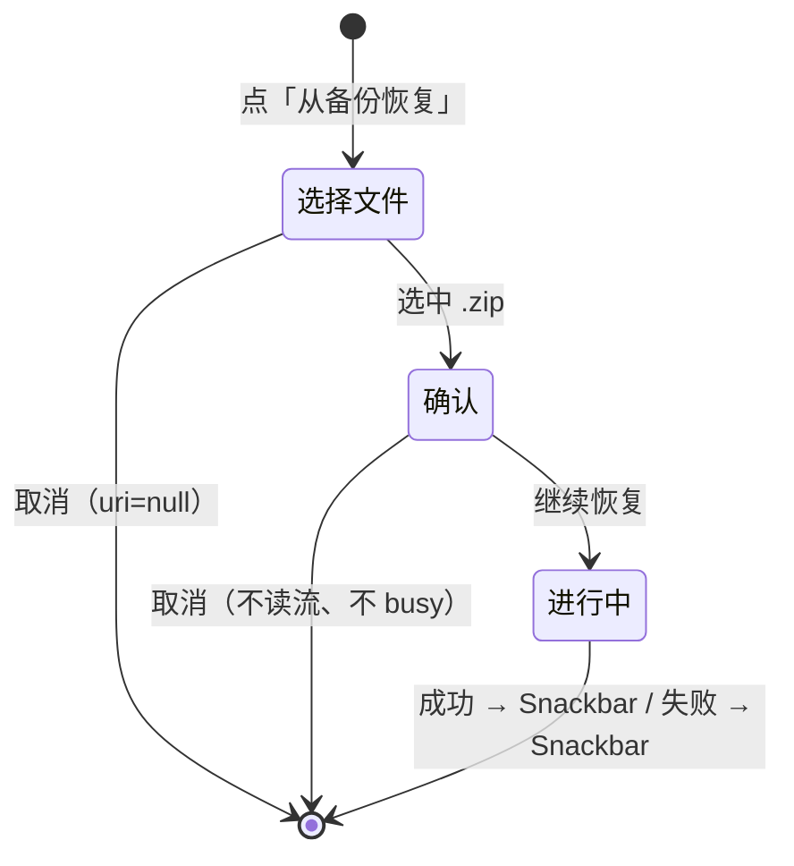

# 页面 · 设置

- 状态：评审通过
- 优先级：P0（D1 恢复确认，T1）
- 关联决策：D1
- 路由：`settings`
- 代码落点：`feature/settings/SettingsScreen.kt`、`SettingsViewModel.kt`

## 1. 目标与入口

从书架顶栏设置图标进入；修改的偏好即时生效并持久化；提供备份导出与恢复（数据可迁移）。

## 2. 布局

```
┌────────────────────────────────┐
│ [←] 设置                        │
├────────────────────────────────┤
│ 默认阅读模式（labelMedium/primary）│
│  ○ 水平分页                      │
│  ○ 垂直滚动                      │
│                                │
│ 主题                            │
│  ○ 跟随系统  ○ 浅色  ○ 深色      │
│                                │
│ 书架排序                        │
│  ○ 标题  ○ 最近阅读              │
│  ○ 添加时间  ○ 大小              │
│                                │
│ 备份与恢复                       │
│  导出备份                       │
│  从备份恢复                     │
│                                │
│ 关于                            │
│  开源许可与第三方声明 →           │
└────────────────────────────────┘
```

- 整页 `verticalScroll`，横向 16dp；分组标题上间距 20dp、下 4dp。
- 每行为整行可点（Row `clickable`），`RadioButton` 默认 48dp 触达。
- 分组顺序固定：阅读模式 → 主题 → 排序 → 备份 → 关于（由轻到重、由常用到低频）。

## 3. 状态矩阵

| 状态 | 触发 | 展示 | 可执行动作 |
|---|---|---|---|
| 正常 | 无备份任务 | 五组内容 | 全部 |
| 备份进行中 | `busy == true` | 备份组替换为：环 + 状态文案 + 线性进度；两个入口隐藏 | 其他分组仍可操作 |
| 备份成功 | 导出完成 | Snackbar `ok_backup_done` | — |
| 恢复成功 | 恢复完成 | Snackbar `ok_restore_done` | — |
| 操作失败 | 异常 | Snackbar `err_backup_op` | — |
| 恢复确认中（T1） | 选完 zip | 确认对话框 | 继续恢复 / 取消 |
| 用户取消 SAF | 系统选择器返回 null | 无任何变化 | — |
| 偏好写失败 | DataStore IO 异常 | 静默（偏好保持旧值） | — |

## 4. 交互细则

### 4.1 偏好单选

1. 点击行任意位置即切换（不等点击 Radio）。
2. 写入后立即生效：
   - 主题 → 全 APP `colorScheme` 变更（`MainActivity` 收集同一流）；
   - 默认阅读模式 → 下次打开文档的初值（**不影响**已打开阅读器的会话模式）；
   - 书架排序 → 书架网格即时重排（与 `SortMenu` 同源）。
3. 写失败静默降级（无副作用可吞），不弹错误。

### 4.2 导出备份

1. 点击「导出备份」→ SAF `CreateDocument("application/zip")`，默认名 `myreader-backup.zip`；
2. 用户确认路径 → 打开 `OutputStream` → 进入 busy 态；
3. 进度：状态文案 + 线性进度（0~1）；
4. 完成 → Snackbar `ok_backup_done`；失败 → `err_backup_op`（`[建议]` 去异常类名，改 `err_backup_invalid` 语境）。

### 4.3 恢复备份（D1 / T1）



- 确认文案见 `copy.md` 的 `dlg_restore_confirm_*`，必须说明「合并」「同名以备份为准」「其他数据不受影响」。
- 取消必须**在打开输入流之前**返回，避免占用文件描述符。
- busy 期间不可再次触发导出/恢复。

### 4.4 关于入口

- 点击「开源许可与第三方声明」→ `navigate(about)`；返回回到设置（设置页状态不重置）。

## 5. 文案

全部键见 `copy.md` 第 10 节（`settings_*`、`ok_backup_done`、`ok_restore_done`、`err_backup_*`、`dlg_restore_confirm_*`）。

## 6. 表单校验

本页无文本输入表单；有效性由系统 SAF 与备份格式校验承担：

| 项 | 规则 | 反馈 |
|---|---|---|
| 备份 zip | `schemaVersion` 兼容校验、`relPath` 白名单 | 失败 Snackbar |
| 输出文件名 | 由 SAF 校验非法字符 | 系统提示 |
| 恢复内容 | 合并式 upsert，不删除现有数据 | 确认对话框预先说明 |

## 7. 无障碍

| 项 | 要求 | 现状 |
|---|---|---|
| 单选语义 | 每行朗读「水平分页，已选中」 | `[已实现]`（RadioButton + 文本） |
| 整行触达 | 整行 ≥ 48dp | `[已实现]` |
| 进度朗读 | 备份百分比可感知 | `[建议 P2]` `progressBarRangeInfo` |
| 焦点 | 从书架进入时焦点落在标题/首个选项 | `[建议 P1]` |
| 对比度 | 分组标题 primary、正文 onSurface | `[已实现]` |

## 8. 响应式

| 场景 | 变化 |
|---|---|
| 手机竖屏 | 单列，全宽行 |
| 平板/横屏 | `[建议 P2]` 内容限宽 600dp 居中，避免超宽行难读 |
| 字体 200% | 整页滚动，行高自适应 |
| 深色 | 即时切换，无闪烁 |

## 9. 验收场景

1. 切主题为「深色」：当前页立即变深，返回书架仍为深色，冷启动保持；
2. 切默认阅读模式为「垂直」：打开 PDF 直接垂直；在阅读器内切水平后再打开新文档仍为垂直（偏好未被回写）；
3. 切排序「大小」：书架立即重排；书架菜单显示同一选中项；
4. 导出备份：选择路径后出现进度，完成 Snackbar；文件可在系统文件管理器中找到；
5. 恢复备份（T1）：选中 zip → 出现确认对话框；取消 → 无进度、无提示、数据不变；确认 → 进度 → `已恢复 N 个文档 / M 个目录`；
6. 恢复损坏/非备份 zip：Snackbar 报错且应用不崩溃；
7. busy 期间点击其他分组不产生并发任务；
8. 字体 200%：无文字被裁切，按钮可见。
